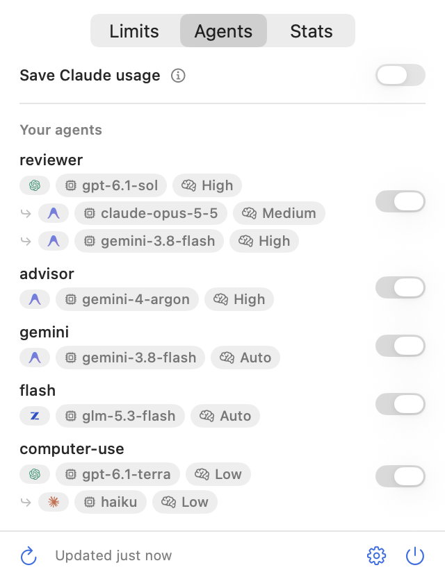
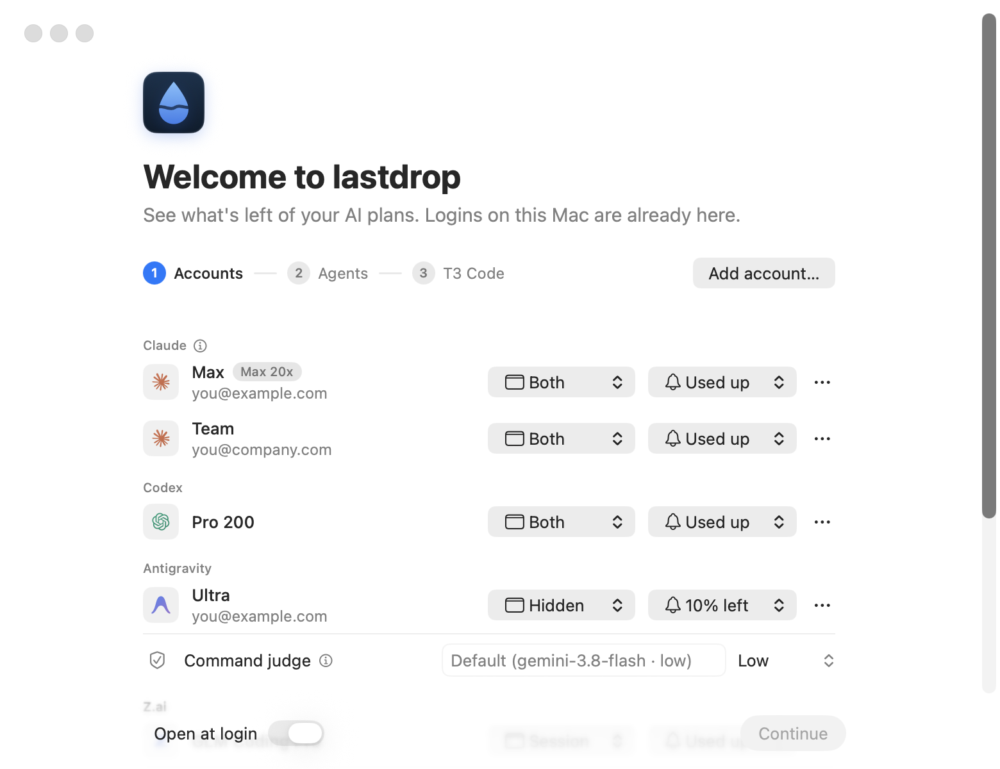
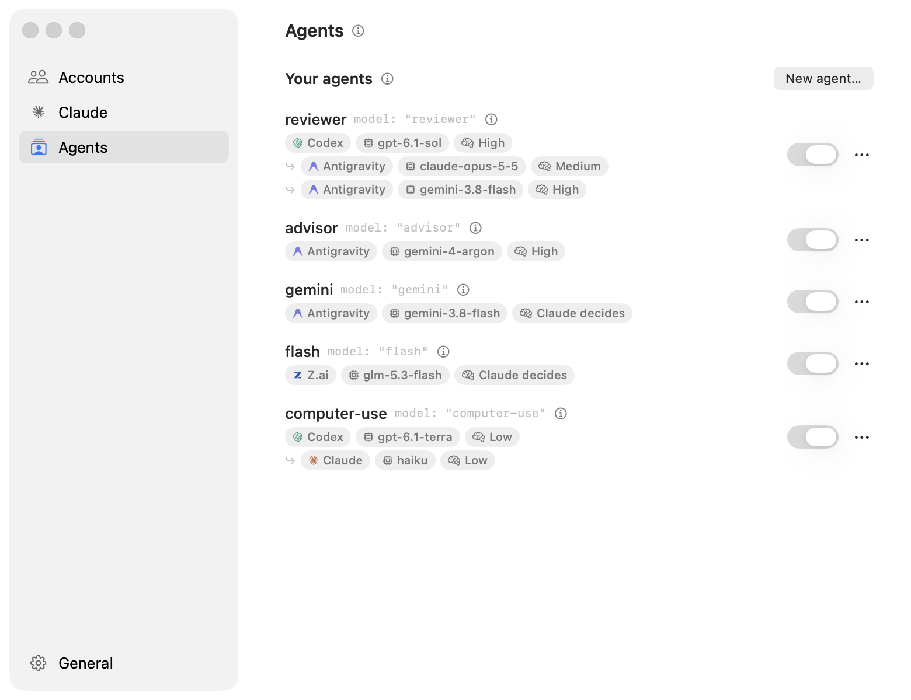
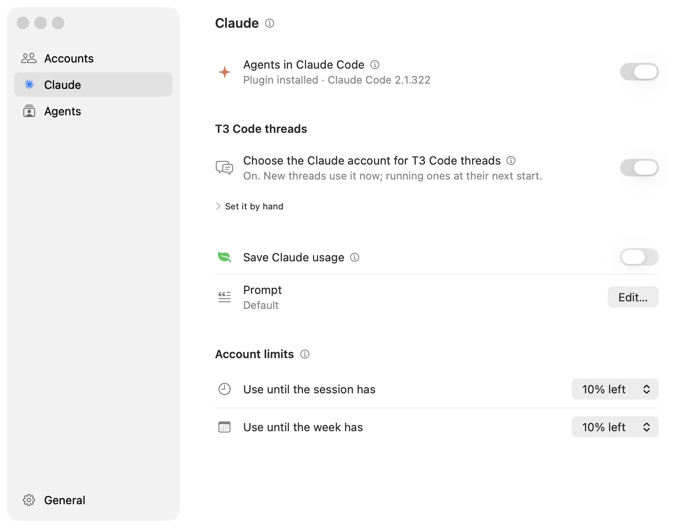
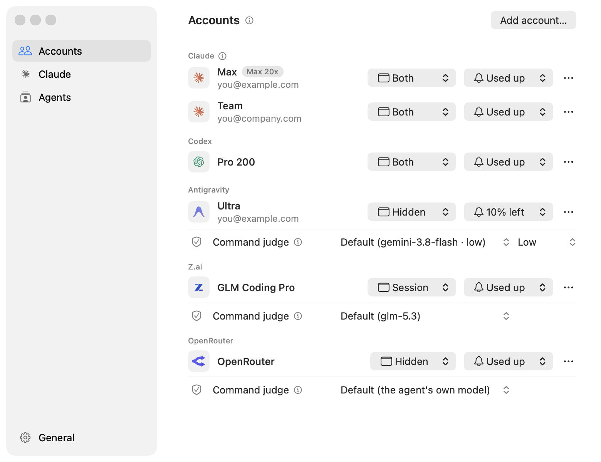

<p align="center">
  
</p>

<h1 align="center">lastdrop</h1>

<p align="center">
  Use any model as a built-in subagent in Claude Code and T3 Code, with a subscription or API key.<br>
  Claude calls them like its native subagents, and lastdrop spreads usage across your accounts.
</p>

<p align="center">
  <a href="https://github.com/amontlabs/lastdrop/releases/latest">Download</a> ·
  <a href="#install">Install</a>
</p>

https://github.com/user-attachments/assets/cf7e7f33-c58a-4633-a22e-8449d3a87664

<p align="center">
  <picture>
    <source media="(prefers-color-scheme: dark)" srcset="docs/images/panel-agents-dark.png">
    
  </picture>
</p>

## What it does

- **Any model as a subagent.** Turn a model on any connected plan into an agent Claude can call: a name, when to
  use it, a model and an effort. Claude Code lists it as an agent type, and Claude calls it like its own:
  `Agent({ subagent_type: "lastdrop:<name>" })`, in every permission mode, auto included.
- **Fallbacks.** Give an agent several models in order. If the first is out of quota or can't start, the next
  one runs.
- **Several Claude accounts, one Claude.** Subagents run on your other Claude accounts, so your main session
  lasts longer.
- **T3 Code threads on the account with room.** Each thread starts on the Claude account with the most usage
  left, your main one included. When that account runs out, your next message continues on another.
- **T3 Code needs only Claude.** Keep the Claude provider in T3 and set up every other model in lastdrop. Claude
  reaches them whenever it delegates.
- **Load-balanced.** Add several accounts per plan. Each agent runs on the account with the most usage left.
- **No approval prompts, no blind trust.** Every command an agent runs is checked. Refused ones come back with
  the reason.
- **Save Claude usage.** A switch that encourages Claude to delegate to your agents.
- **Limits in the menu bar.** Usage left on each account, when it resets, and the limit resets you can still spend.
- **Stats.** Tokens, API prices and agents by day, project, account and model, across Claude Code, Codex and
  Antigravity.

## Install

You need macOS 15 or later. The agent features need [Claude Code](https://docs.anthropic.com/en/docs/claude-code), on its own or
inside T3 Code.

1. Download `lastdrop.zip` from the [latest release](https://github.com/amontlabs/lastdrop/releases/latest)
   and move `lastdrop.app` to Applications.
2. The app isn't notarized yet, so clear the download flag before the first launch:

```sh
xattr -dr com.apple.quarantine /Applications/lastdrop.app
```

3. Open it and follow the setup: your accounts, then agents (optional).

lastdrop keeps itself up to date: it looks for a new release every hour and downloads it in the background. Your
panel then offers **Restart**. Running subagents keep going, and **Settings → General** has the switch. Coming from
Headroom 0.1.0, install this version by hand once.

To build it yourself, you need the Swift 6 toolchain (Command Line Tools are enough):

```sh
git clone https://github.com/amontlabs/lastdrop.git
cd lastdrop
./script/build_app.sh
rm -rf /Applications/lastdrop.app && cp -R dist/lastdrop.app /Applications/
```

<p align="center">
  <picture>
    <source media="(prefers-color-scheme: dark)" srcset="docs/images/setup-dark.png">
    
  </picture>
</p>

## Agents in Claude Code and T3 Code

Turn on **Agents in Claude Code** in **Settings → Claude**. It works in the terminal, in the Claude
desktop app and in T3 Code.

**Your agents.** In **Settings → Agents**, click **New agent…** and pick a name, when Claude should use it, a
plan, a model and an effort. Add more models under it as fallbacks: the next one runs only if the one above
can't start, never once work has begun. Claude sees the agent in the Agent tool's list of models, and its steps
show live while it works. Each report starts with the model it ran on. You can also just ask Claude to add or
change an agent: it uses `lastdrop --agents`. In T3 Code, Claude reaches the same agents from a subagent
(Agent) or a task in its own thread (`delegate_task`).

<p align="center">
  <picture>
    <source media="(prefers-color-scheme: dark)" srcset="docs/images/settings-agents-dark.png">
    
  </picture>
</p>

**Commands are checked, nobody is asked.** Read-only commands such as `ls` or `git status` run straight away.
The rest go through a check:

- Claude agents: Claude Code's auto mode, with your rules.
- Codex: its own reviewer.
- Z.ai and OpenRouter: Claude Code's own check, run by a judge model on that plan.
- Antigravity: your Claude Code permission rules, then a judge model on your plan.

You pick each judge model under that provider's accounts in **Settings → Accounts**. A refused command is named
in the report, with the reason.

**Claude's subagents.** They run on your smallest Claude account that still has room (10% left by
default, down to 0% in **Settings → Claude**) for their model, Fable's own weekly limit included: a Pro's 5-hour
window resets whether you used it or not. The session's own account takes them too, but keeps 20 points for the
session itself. A plan with no 5-hour window (Ultra) counts only its weekly limits. Badges in the panel show where new work goes: **Threads**, **Subagents**, and **Fable**. Each one is a normal Claude Code process with the same folder, model, permissions and MCP servers.
The model never changes, only the account. `/agents-elsewhere` lists what runs where.

**T3 Code threads.** lastdrop can also choose the Claude account for each T3 Code thread, your main account
included. A new thread starts on the account with the most room. A running thread stays on its account while
its prompt cache is warm, and moves only when that costs nothing: its cache has expired, or it was just
compacted. When its account runs out, lastdrop ends that thread's Claude between turns and notifies you, and
your next message continues on another account. Turn it on in **Settings → Claude → T3 Code threads** (or the
T3 Code step in setup). It sets T3 Code's **Settings → Providers → Claude → Binary path** for you, asks before
replacing a path you set yourself, and puts it back when you turn it off. The path is also there to copy by
hand.

**Save Claude usage.** In **Settings → Claude**. Adds a prompt that encourages Claude to delegate
implementation, exploration, reviews and research. **Edit…** shows it and lets you change it.

<p align="center">
  <picture>
    <source media="(prefers-color-scheme: dark)" srcset="docs/images/settings-claude-dark.png">
    
  </picture>
</p>

How it works, with the tests behind it: [docs/claude-accounts.md](docs/claude-accounts.md) and
[docs/agents.md](docs/agents.md).

## Accounts

Logins already on your Mac show up on their own. To add one, use **Settings → Accounts → Add account…**

| Plan | How you connect it | Agents |
| --- | --- | --- |
| Claude | Sign in with Claude, in your browser | Subagents |
| Codex | Sign in with ChatGPT, in your browser | Yes |
| Antigravity | Sign in with Google, in your browser | Yes, first account only |
| Z.ai | A Coding Plan API key | Yes |
| OpenRouter | An API key | Yes |

Add as many accounts per plan as you like. For each, pick what the menu bar shows and when you get notified.

<p align="center">
  <picture>
    <source media="(prefers-color-scheme: dark)" srcset="docs/images/settings-accounts-dark.png">
    
  </picture>
</p>

## Privacy

Everything stays on your Mac. lastdrop reads usage from each provider with the logins you already have. Its
own keys and the Claude sign-ins you add are in the keychain. Logs are in `~/Library/Logs/lastdrop`.

What it writes outside its own folders:

- An expiring Codex token, renewed the way the Codex CLI does it.
- Its plugin, added to Claude Code when **Agents in Claude Code** is on.
- A profile per extra Claude account, in `~/.claude-accounts/<name>/profile`: links to `~/.claude`, plus a copy
  of `~/.claude.json` with that account's own state. `~/.claude.json` itself is only read.
- T3 Code's Claude binary path, when **T3 Code threads** is on. Turning it off puts it back.

The Stats tab reads the transcripts these tools keep on your Mac and saves only hourly totals, in
`~/Library/Application Support/lastdrop/usage.sqlite`: tokens, models and project names, never your messages.
Prices are what the same tokens would cost on each provider's API, not what you paid.

## Development

```sh
swift run lastdrop           # run without building the app bundle
swift run lastdrop --print   # fetch every account once and print it
swift test
claude plugin test ClaudePlugin/lastdrop
```

`LASTDROP_DEMO=1 swift run lastdrop --snapshots <folder>` renders every screen with made-up accounts.

## License

MIT, see [LICENSE](LICENSE). Provider logos come from [OpenUsage](https://github.com/robinebers/openusage)
(MIT), which also inspired this app.
